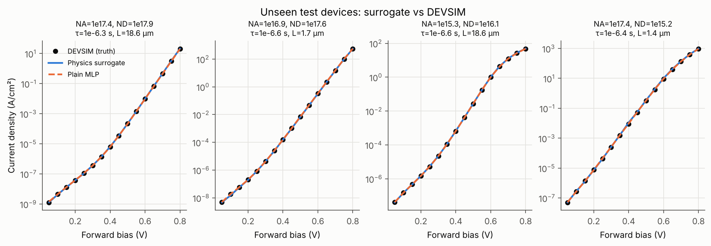
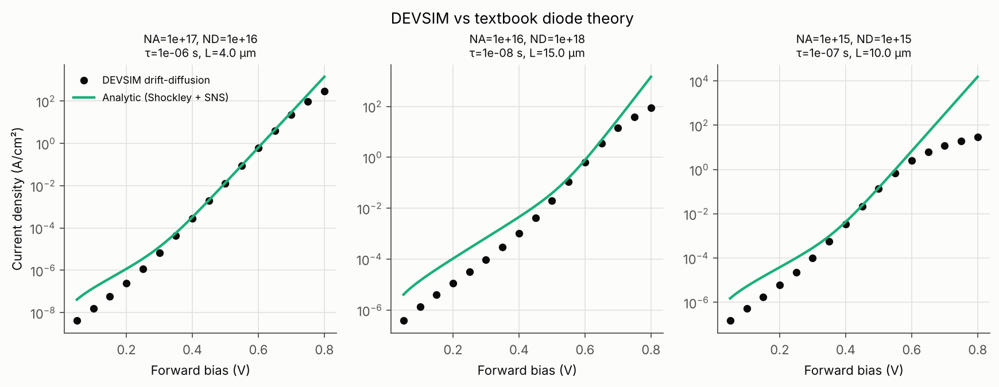
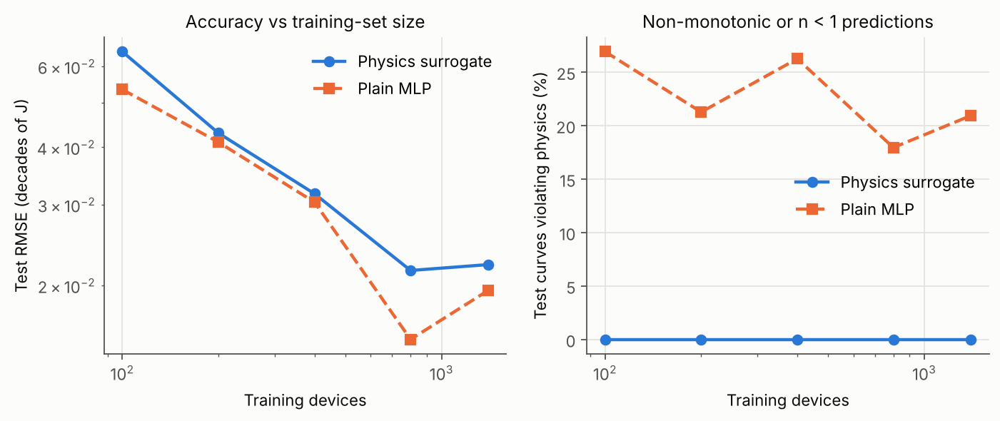
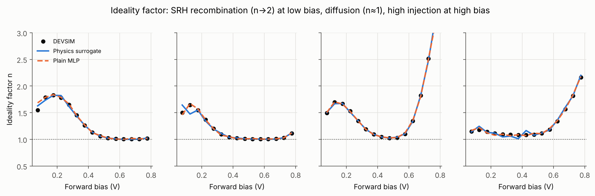
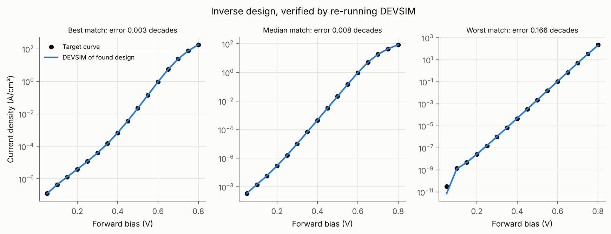

# Physics-Constrained Neural Surrogate for PN-Diode TCAD

A neural network that replaces a drift-diffusion TCAD simulation of a silicon PN diode, predicting the full forward I–V curve in **~0.1 ms instead of ~1.7 s**, while **guaranteeing physically valid curves** (monotonic current, ideality factor n ≥ 1). The same network is then run in reverse for **inverse design**: given a target I–V curve, it finds the doping, lifetime and length that produce it, and every answer is **verified by re-running the TCAD simulation**.

Everything is built on [DEVSIM](https://devsim.org), an open-source TCAD simulator, so the whole pipeline is reproducible on a laptop.



---

## Why this matters

Device and process engineers run thousands of TCAD simulations for design-space exploration, sensitivity studies and parameter extraction. Each one takes seconds to hours. A trained surrogate answers instantly, which makes optimisation loops, Monte Carlo variability studies and inverse design practical.

The catch is that a plain neural network can return curves that no real device could produce. This project builds the physics *into the architecture*, so invalid curves are impossible by construction rather than discouraged by a penalty term.

## Pipeline

```
 Latin-hypercube sampling ──► DEVSIM drift-diffusion ──► 1,999 I–V curves
   (NA, ND, τ, L)              (Poisson + continuity + SRH)       │
                                                                   ▼
   Inverse design ◄── Physics-constrained surrogate ◄── training (70/15/15 split)
   (gradient descent                │
    on the inputs)                  └──► compared with a plain-MLP baseline
        │
        └──► best design re-simulated in DEVSIM to verify
```

| Design parameter | Range | Sampling |
|---|---|---|
| Acceptor doping, NA (p-side) | 10¹⁵ – 10¹⁸ cm⁻³ | log-uniform |
| Donor doping, ND (n-side) | 10¹⁵ – 10¹⁸ cm⁻³ | log-uniform |
| SRH carrier lifetime, τ | 10⁻⁸ – 10⁻⁵ s | log-uniform |
| Device length, L (junction at centre) | 1 – 20 µm | uniform |

The range deliberately covers both **short-diode** (L ≪ diffusion length) and **long-diode** (L ≫ diffusion length) regimes, so the surrogate has to learn the transition between them.

**Output:** log₁₀ J at 16 forward-bias points, 0.05 – 0.80 V.

---

## Step 1: Is the simulation physically correct?

Before training anything, the TCAD set-up is checked against textbook theory: the Shockley diffusion current (general short/long-diode form with coth terms) plus Sah–Noyce–Shockley depletion-region recombination (`src/validate_physics.py`).



- In the **diffusion-dominated region (0.4–0.6 V)**, DEVSIM matches the analytic model to **0.03 decades** for the reference short diode.
- At **low bias**, DEVSIM sits below the analytic curve. This is expected: the SNS expression assumes recombination across the *whole* depletion width, which is an upper bound. In reality it peaks only where n ≈ p.
- At **high bias**, DEVSIM rolls off below the exponential. This is **high-level injection** (injected carriers exceed the doping on the lightly doped side, so n → 2) combined with **ohmic drop** in the neutral regions. It's most visible in the 10¹⁵/10¹⁵ device, as expected.

These deviations are exactly the non-ideal physics a simple formula misses, and the reason a learned surrogate is useful.

## Step 2: Physics built into the network

Instead of predicting 16 current values directly, the network predicts the current at the first bias point and then the **rise between each pair of bias points**:

```
log J(V₁)          free
ΔₖlogJ             forced > 0                         → current always increases (monotonic)
ΔₖlogJ / ΔV        bounded < 1/(ln10 · kT/q) ≈ 16.8 dec/V  → ideality factor n ≥ 1
                   (applied for V ≥ 0.15 V)
```

The bound comes from basic diode physics: at 300 K no diode can be steeper than ~60 mV per decade of current. It's applied only above 0.15 V (≈ 6 kT/q). Below that, the "−1" in J₀(e^{V/V_t} − 1) can make log J legitimately steeper than 1/V_t, and in very heavily doped devices the current approaches the solver's precision floor. Applying the bound there would be *wrong*. (I found this by checking the training data: 1.2 % of curves exceed the n = 1 slope below 0.15 V, and **none** do above it. My first version applied the bound everywhere and lost accuracy because of it.)

See `src/model.py`. The baseline `PlainMLP` has the same hidden layers (3 × 128, SiLU) but no constraints.

## Results

Test set: 301 devices never seen in training.

| Metric | Physics surrogate | Plain MLP |
|---|---|---|
| RMSE (decades of J) | **0.020** | 0.024 |
| Median \|error\| in J | 1.3 % | **0.9 %** |
| 95th-percentile \|error\| in J | 5.7 % | **4.3 %** |
| Curves violating physics (non-monotonic or n < 1) | **0 / 301 (0 %)** | 50 / 301 (16.6 %) |
| Inference time, one device | ~0.15 ms | ~0.10 ms |
| DEVSIM, one device (single core) | ~1.7 s | ~1.7 s |

**What this shows, honestly:** both models are accurate to a few percent. The plain MLP is slightly better on typical points, and the physics model has fewer large errors (lower RMSE). The real difference is **trustworthiness**: about 1 in 6 plain-MLP curves are physically impossible somewhere along the curve. The violations are small (lowest predicted n = 0.96), but they would corrupt any downstream ideality-factor or parameter extraction. The physics model has **zero violations at every training-set size**:



### The surrogate learns the device physics, not just the curve

The ideality factor n(V) is a sensitive test, because it depends on the *slope*, and small curve errors become large n errors. The surrogate reproduces all three physical regimes:



- **n → 1.5–2 at low bias:** SRH recombination in the depletion region dominates
- **n ≈ 1 at mid bias:** ideal minority-carrier diffusion
- **n rises at high bias:** high-level injection and series resistance (strongest in the lightly doped device, third panel)

## Step 3: Inverse design, verified in TCAD

Since the surrogate is differentiable, it can be optimised with respect to its **inputs**: given a target I–V curve, find (NA, ND, τ, L). Each search uses 32 random starts × 600 Adam steps (well under a second), and inputs stay inside the design range through a sigmoid mapping. The best design is then **re-simulated in DEVSIM** (`src/inverse_design.py`).



On 20 unseen target curves:

| Result | Value |
|---|---|
| Targets matched within 0.05 decades (DEVSIM-verified) | **19 / 20** |
| Median DEVSIM-verified error | 0.0074 decades (≈ 1.7 % in J) |
| Median error, log₁₀ doping of **lightly** doped side | **0.05** |
| Median error, log₁₀ doping of **heavily** doped side | 0.17 (≈ 3× worse) |
| Median error, log₁₀ τ | 0.03 |

**The physics insight:** the forward current is controlled mainly by the **lightly doped side** (J₀ ∝ 1/N for each side, so the smaller N dominates). The I–V curve therefore carries little information about the heavily doped side, and the inverse problem is **ill-posed** in that direction. The optimiser finds the light-side doping and the lifetime reliably, but different heavy-side dopings give near-identical curves. A real process engineer would need an extra measurement (for example C–V profiling) to pin it down.

The one miss (0.17 decades) is a heavily doped, long-lifetime device whose error comes entirely from the 0.05 V point, where the current is ~10⁻¹¹ A/cm². That's at the simulator's numerical precision floor (see Limitations).

---

## How to run

```bash
git clone https://github.com/<your-username>/pn-diode-surrogate.git
cd pn-diode-surrogate
pip install -r requirements.txt

python src/simulate.py                       # one example device, prints J–V
python src/validate_physics.py               # DEVSIM vs analytic theory
python src/generate_dataset.py --n 2000      # ~30 min on 2 cores (dataset is already included)
python src/train.py                          # ~2.5 min on CPU, writes models/ and results/
python src/inverse_design.py --n_targets 20  # ~1 min
```

**If DEVSIM reports "Error loading math libraries":** it needs a BLAS/LAPACK library.
- Linux: `sudo apt install libopenblas-dev`, or point `DEVSIM_MATH_LIBS` at any `libopenblas*.so`
- Windows / macOS: `pip install mkl`

## Repository structure

```
src/
  simulate.py           DEVSIM 1D PN-diode model (mesh, doping, Poisson + drift-diffusion, bias sweep)
  generate_dataset.py   Latin-hypercube sampling + parallel simulation
  validate_physics.py   comparison with Shockley + Sah-Noyce-Shockley theory
  model.py              physics-constrained surrogate, plain-MLP baseline, ideality factor
  train.py              training, evaluation, data-efficiency study, figures
  inverse_design.py     gradient-based inverse design + DEVSIM verification
  plot_style.py         shared figure style
data/diode_iv_dataset.csv   1,999 simulated devices (4 inputs + 16 log10 J values)
models/                     trained weights
results/                    metrics.json, figures, inverse-design results
```

## Limitations and next steps

- **Simplified physics:** constant mobility (µn = 400, µp = 200 cm²/V·s), no bandgap narrowing, no Auger recombination, abrupt junction, 1D. Results above ~10¹⁸ cm⁻³ would need doping-dependent mobility (for example Klaassen, already included in DEVSIM) and BGN.
- **Numerical floor:** for heavily doped, long-lifetime devices, currents near 0.05 V (≲10⁻¹⁰ A/cm²) are limited by the solver's absolute tolerance. This affects about 0.75 % of curves at the first bias point only.
- **Forward bias only.** Reverse leakage and breakdown would be a natural extension.
- **Next steps:** a graded or Gaussian implant profile; a Schottky diode with thermionic-emission boundary conditions; temperature as an input (then the n ≥ 1 bound becomes temperature-dependent); uncertainty estimates with a deep ensemble; and a 2D MOSFET surrogate.

## Author

**Sherin Christiane Selvakumar**, B.E. Electronics and Communication Engineering (2026), Sathyabama Institute of Science and Technology
Research interests: semiconductor device physics, TCAD, and machine learning for device and process engineering.
[LinkedIn](https://www.linkedin.com/in/sherin-christiane/)

## License

MIT, see `LICENSE`.
